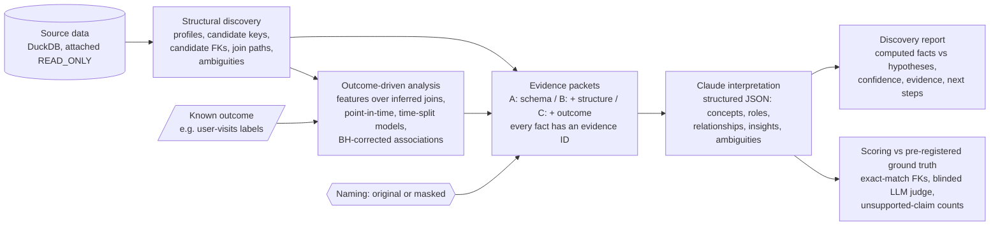

# semantic-discovery-engine

**An experimental AI system that combines relational analysis, outcome-driven modeling, and LLM reasoning to automatically infer
business meaning and discover insights from unfamiliar datasets.**

> **Status: working prototype, two experiments run.**
> - **Experiment 1 (public RelBench Avito):** inconclusive. The model recognized the dataset even with names masked, so the schema-only baseline hit the ceiling.
> - **Experiment 2 (synthetic SaaS warehouse the model cannot have seen):**
>   - With names masked, *structural* evidence raised column-meaning accuracy from 0.68 to 0.94.
>   - *Outcome* evidence surfaced 94% of the planted business signals, with no wrong-direction or spurious claims, but did not improve interpretation further.
>   - With real (even cryptic) names, every configuration was near-perfect.
> - See [EVALUATION.md](EVALUATION.md). The structural result is exploratory: the pre-registered H1 measured relationships and fell inside run-to-run noise.

## The problem

Companies hold far more structured data than anyone understands. Before an AI analyst can answer a question, someone has to tell it:
- which tables matter;
- how they join;
- what an "event" or "account" is;
- how metrics are defined.

Today that "semantic layer" is written by hand. LLMs are good at analysis *once that context exists*. They are not reliable at building it
from a large, undocumented database.

## The hypothesis

An LLM can reconstruct more of that semantic layer, with less human help, if it reasons over two kinds of grounded evidence:
1. **Structural evidence:** keys, value overlap, cardinality, time columns and join paths, computed deterministically.
2. **Outcome-driven evidence:** which relationships actually help predict a business outcome the organization already tracks.

The point of the second is not prediction. A known outcome gives the system a signal for *where to look*. If an undocumented event table
predicts conversion, it is probably worth understanding.

**We test this against simpler baselines, and "the simpler one wins" is an acceptable answer.**

## Architecture



| Module | What it does |
|---|---|
| [`sde/structure.py`](sde/structure.py) | Name-agnostic profiling, candidate keys, inclusion-based foreign-key candidates with coverage, density and cardinality evidence, best-parent ranking, join paths, ambiguity detection |
| [`sde/outcome.py`](sde/outcome.py) | Bounded relational feature synthesis (≤ 2 hops) over *inferred* edges; point-in-time filtering; gradient boosting and logistic regression on time splits; permutation importance; Benjamini–Hochberg; stability across cutoffs |
| [`sde/evidence.py`](sde/evidence.py) | Builds the A/B/C evidence packets; masks names; holds the prompt and the JSON output schema |
| [`sde/llm.py`](sde/llm.py) | Claude client with structured output. Every call is recorded to disk and replayed, so results can be re-scored without an API key |
| [`sde/scoring.py`](sde/scoring.py) | Ground-truth scoring, the blinded judge, unsupported-claim and human-review counts |
| [`sde/report.py`](sde/report.py) | Experiment summary (with the pre-registered decision rule) and the human-readable discovery report |

**Not here, on purpose:** a knowledge graph, an agent loop, a vector database, or a semantic layer export. Each is a reasonable next step
only if the experiment shows the combined evidence actually helps. See [PRODUCT_DECISIONS.md](PRODUCT_DECISIONS.md).

## Setup

Requires Python 3.10+. Tested with 3.12 and [uv](https://docs.astral.sh/uv/).

```bash
uv venv --python 3.12 .venv && uv pip install --python .venv -r requirements.txt
```

To run the LLM stage, put your key in `.env` (gitignored; see `.env.example`):

```bash
cp .env.example .env
```

## Usage

Download about 365 MB from RelBench and build the local read-only DuckDB:

```bash
.venv/bin/python -m sde prepare
```

Run the deterministic stages (no API key needed; about 30 seconds):

```bash
.venv/bin/python -m sde outcome && .venv/bin/python -m sde packets && .venv/bin/python -m sde report
```

Run the full experiment: 18 interpretation calls and 18 judge calls on `claude-opus-5-5`, about $6 per dataset:

```bash
.venv/bin/python -m sde all
```

Run it on the synthetic SaaS warehouse. The data is generated locally from a fixed seed, in about a minute:

```bash
.venv/bin/python -m sde all --dataset saas
```

Re-score and re-report from the recorded LLM responses without calling the API:

```bash
.venv/bin/python -m sde all --replay-only
```

Run the tests:

```bash
.venv/bin/python -m pytest -q
```

Outputs go to `results/avito/`:
- `summary.md`, the experiment results;
- `structure.json` and `outcome.json`, the computed evidence;
- `packets/`, exactly what the LLM saw per configuration;
- `runs/` and `judge/`, the raw model outputs;
- `judge_audit/`, for human review;
- `discovery_report_C_*.md`, the end-user report.

## Example results

On RelBench `rel-avito`. These are measured; full detail is in [EVALUATION.md](EVALUATION.md).

- **Structural discovery** finds all 5 primary keys.
  - It recovers all 11 true foreign keys inside a list of 29 "preferred" candidates (precision 0.38).
  - Because keys are dense integer ranges, value overlap alone cannot separate real links from coincidences, such as IP-address IDs that "fit" inside search IDs.
- **Outcome-driven analysis** scores 0.671 test AUROC on the user-visits task, against 0.655 for one activity count.
  - It correctly concentrates importance on the table the outcome is defined on, without being told which table that is.
  - Two features built on a *false* join still pass multiple-testing correction. This is a concrete case of statistical significance that is not semantic validity.
- **Synthetic SaaS warehouse** (Experiment 2, 18 runs, $5.93):
  - masked-name column accuracy was 0.68 with schema only, 0.94 with structural evidence, 0.91 with outcome evidence as well;
  - planted signals recovered: 0%, 0% and 94%;
  - zero invalid citations, zero overconfident errors and zero spurious claims in every configuration.
- **Avito LLM comparison** (Experiment 1, 18 runs, $5.55): every configuration recovered all 11 relationships and all 8 table concepts.
  - With masked names, column-meaning scores were 0.94–0.96 in every configuration. The structural and outcome evidence added cost (1.4–1.6×) with no measurable accuracy gain.
  - The baseline was at the ceiling, probably from recognizing the dataset, so this does **not** show the evidence is useless. It shows this benchmark can't measure it.

## Limitations

- **One dataset, one domain.** Every claim is specific to `rel-avito`.
- **Evidence for the hypothesis is partial and comes from one synthetic dataset.** Structural evidence helped interpretation (exploratory). Outcome evidence helped discovery but not interpretation.
  The synthetic generator is far cleaner than a real warehouse.
- The semantic ground truth was reconstructed from public documentation by the developer and needs human verification.
- **The data is public**, so the model may have memorized it. The masked-name condition is the main mitigation; it is not a guarantee.
- Static tables with no timestamps cannot be time-filtered.
- Nothing here produces *governed* definitions. The system can propose what a column probably means, but not what the organization has agreed it means.

## Repository layout

```
eval/protocol.md               pre-registered methodology (committed before any results)
eval/ground_truth/avito.json   answer key: RelBench FK metadata + documented semantics
sde/                           implementation
tests/                         pytest suite (leakage, read-only source, masking, scoring)
results/avito/                 every computed artifact behind every reported number
README.md  PRODUCT_DECISIONS.md  EVALUATION.md
```

Data: [RelBench](https://relbench.stanford.edu) (`rel-avito`, `rel-f1`), downloaded at run time and never committed. `rel-avito` comes from
the Avito Context Ad Clicks Kaggle competition. Check the original licence terms before redistributing any data.
